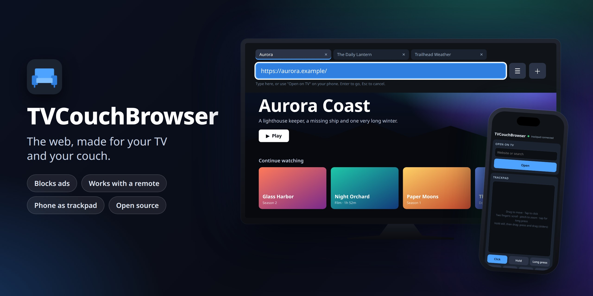
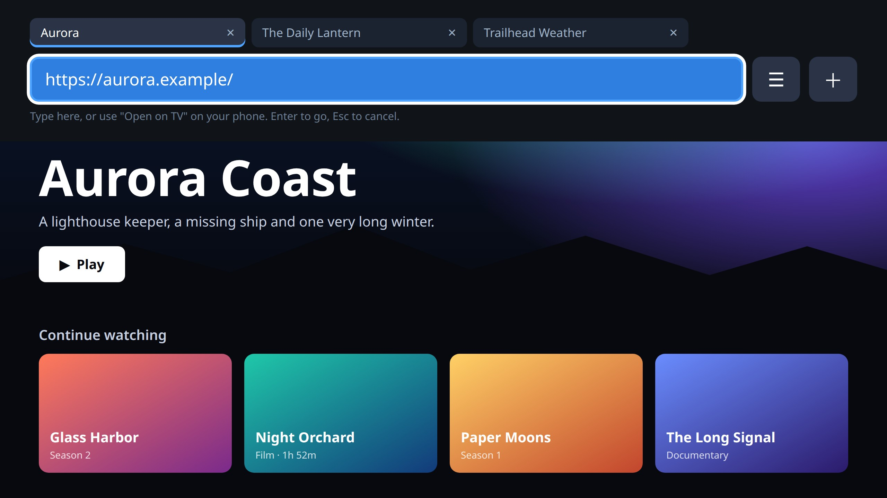
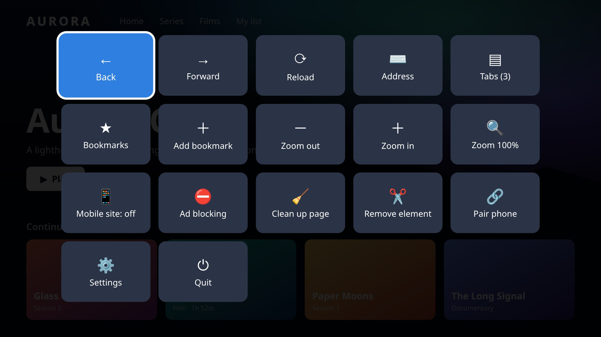
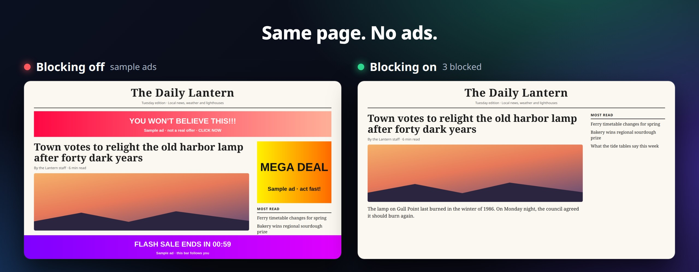
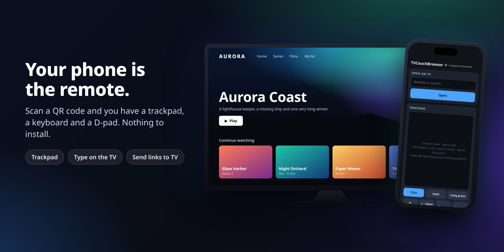

# TVCouchBrowser for Linux and macOS

A couch browser for Pop!_OS, Ubuntu and macOS, for a computer connected to a TV. It blocks ads, works with a
remote or keyboard, and lets you type from your phone. It is a port of
[TVCouchBrowser for Android TV](https://github.com/crash101g/tvcouchbrowser) by crash101g.

- **Ad blocking** with EasyList, EasyPrivacy, the uBlock Origin lists, AdGuard Popups and Peter Lowe's list,
  updated once a day.
- **Clean up page** and **Remove element** for whatever the lists miss.
- **Two ways to use a remote**, switched by holding OK: a pointer (cursor mode) or jumping between links
  (link mode).
- **Your phone as a trackpad, keyboard and remote**: scan a QR code, nothing to install.
- **Send to TV** from the iPhone share sheet: see [docs/send-to-tv-shortcut.md](docs/send-to-tv-shortcut.md).
- **Widevine**, so streaming sites can play protected video. Services that require more than software
  Widevine (L3) may refuse or limit quality; upstream has the same limit.

## Screenshots

Move the mouse to the top of the screen or press F6 for the address, your tabs and the menu:

Everything else is in a menu made for a remote:

The ad blocker on and off, on the same page:

Your phone becomes a trackpad, keyboard and remote:

These are from the real app. The sites in them are made up for the pictures, and the ads are samples.

## Install on Linux

Build and install a package (no root needed to build):

    tools/build-deb.sh
    sudo apt install ./dist/tvcouchbrowser_0.3.0_amd64.deb

It then appears in the app launcher as **TVCouchBrowser**, or run `tvcouchbrowser`. To remove it:
`sudo apt remove tvcouchbrowser`.

Or run it from this folder without installing:

    ./run.sh                     # full screen
    ./run.sh --windowed          # in a window
    ./run.sh https://example.com

Either way it downloads the Chromium runtime once (about 120 MB, checked against a pinned hash). On first
run it also downloads the filter lists and, from Google, the Widevine module. Settings are in
`~/.config/tvcouchbrowser/`.

## Install on macOS

For Macs with Apple silicon (M1 or later), macOS 13 or later, including macOS 27. Intel Macs aren't supported.
**This build has not yet been run on a real Mac.** Its logic is tested on Linux, and `test/run.sh` run on a
Mac is the real check.

Build it on the Mac (Terminal, in this folder). Streaming sites need the app signed by
[castLabs' EVS](https://github.com/castlabs/electron-releases/wiki/EVS), a free service, so that comes first:

    pip3 install --user castlabs-evs
    python3 -m castlabs_evs.account signup    # once
    tools/build-macos.sh
    ditto -x -k dist/TVCouchBrowser-0.3.0-macos-arm64.zip /Applications

Pass `--no-evs` to `tools/build-macos.sh` to skip EVS: everything works except protected video. So does
`./run.sh`, which needs no build, and has the same limit: without EVS signing, streaming services refuse the
license. Settings are in `~/Library/Application Support/tvcouchbrowser/`.

The app is signed ad hoc, not with an Apple Developer ID. A copy built on the Mac itself just opens. A copy that
arrived by download, AirDrop or message is called "damaged" by macOS until you clear the quarantine flag:

    xattr -dr com.apple.quarantine /Applications/TVCouchBrowser.app

`tools/build-macos.sh` also runs on Linux, with [rcodesign](https://github.com/indygreg/apple-platform-rs) on the
PATH, but the copy then needs the `xattr` step above, so building on the Mac is simpler.

What is different on a Mac:

- macOS asks to allow **incoming connections** and **Local Network** access: allow both, or the phone can't
  connect. It may ask for **Keychain** access too, and again after each rebuild, because the signature is ad hoc.
- Use **Cmd** for Cmd+L, Cmd+T, Cmd+R and Cmd+Q; Ctrl still works, for a remote's keyboard. On an Apple keyboard, F6
  may need Fn. In full screen, the macOS menu bar slides down along with the address bar.
- F11 and F1 are taken by macOS or the brightness key. Use **Ctrl+Cmd+F** for full screen, and **hold Esc** (or
  Fn+F1) for the menu. Mac keyboards have no Menu key.
- Media keys go to macOS rather than the app, so they control whatever is playing through the system. They
  don't get the app's 10 s and 60 s jumps.

## Remote and keyboard

USB and Bluetooth "air" remotes act as keyboards, so any of them should work.

| Key | What it does |
|---|---|
| Arrows | Cursor mode: moves the pointer (slow at first, faster while held); at the screen edge the page scrolls. Link mode: jumps to the nearest link, button or field in that direction, or scrolls when there is none. |
| Enter (OK) | Clicks what is under the pointer, or the link with the ring around it |
| Hold Enter | Switches between cursor mode and link mode |
| Esc, Backspace or Back | Leaves a text field, then a dialog or full-screen video, then goes back a page, then shows the start screen |
| Menu key, F1, or hold Esc | Opens the menu |
| Play/Pause, Fast-forward, Rewind | Act on the page's video (FF/Rewind: 10 s) |
| Next, Previous | Jump 60 s forward or back |
| Channel up/down | Page up/down |
| F11 | Full screen or window |
| F6 | Shows or hides the top bar: the page's URL, a ☰ menu button and, with two or more tabs, the tabs, each with a × to close it, and a ＋ for a new tab |
| Ctrl+L, Ctrl+T, Ctrl+R or F5, Ctrl+Q | Address, new tab, reload, quit |

While a text field has focus, keys go to the field; press Esc to get the remote back. A real mouse works
as usual. Move it to the very top of the window to show the top bar; it hides again when you move away, unless
you clicked or typed in the address. With a remote in the bar, Up reaches the tabs, Right from a tab reaches its ×,
and Right at the end of the address reaches ☰, then ＋. On the start screen, hold Enter (or right-click) a bookmark tile to move or
remove it.

Unlike Android TV, this has no on-screen keyboard, so to type with only a remote, use your phone.

## Blocking what the lists miss

- **Clean up page** (menu, or the phone page) removes full-screen overlays, cookie and newsletter walls and
  sticky ad bars, and makes a scroll-locked or blurred page usable again. Menu → Ad blocking → **Clean up
  this site automatically** runs it on every page load.
- **Remove element**: in the menu, then point at the thing and press OK (or tap **✂ Remove** on the phone
  trackpad). The browser remembers it for that site. Menu → Ad blocking → **Bring back removed elements**
  undoes it.
- **Pop-ups**: windows opened without a click are blocked. After a click, a window to a filtered ad domain
  (including AdGuard's `$popup` rules) is dropped, a window to the same site opens in a tab, and a window to
  another site asks first. A page that redirects itself to an ad domain without a click is stopped.
- **Dialog loops**: a page gets two alert/confirm boxes; more are dismissed. "Leave this page?" never traps Back.
- **Captchas are never blocked** (reCAPTCHA, hCaptcha, Cloudflare Turnstile, Arkose). Clicks from the remote
  and the phone trackpad are trusted input events, which captchas require.
- **Filter lists**: Menu → Ad blocking → **Filter lists…** turns lists on or off.

**This is not uBlock Origin.** The blocker understands the common filter-list rules (blocking by domain and
by path, first/third party, exceptions, and element hiding with standard CSS). It skips regex rules,
`$domain=` rules, redirects and uBO's scriptlets. On YouTube, a small script removes the ad entries from the
player data; YouTube may change or detect this.

## Your phone

Menu → **Pair phone** shows a QR code. Scan it and a page served by this computer opens: open a website, type
into the selected field, use the D-pad remote, or use the trackpad.

| On the trackpad | What it does |
|---|---|
| Drag one finger | Moves the pointer (set **Speed** below the pad) |
| Tap | Click |
| Hold still, then drag | Press and drag: sliders, slide-to-unlock captchas, maps |
| Hold still, then let go | Long press (a right click) |
| Two fingers: drag / pinch / tap | Scroll / zoom / long press |
| **Hold** button | Pressed for as long as your finger stays on it |
| **✂ Remove** / **🧹 Clean up** | Remove the element under the pointer / clean up the page |

If the phone can't connect and you turned on a firewall, allow the port: `sudo ufw allow 8765/tcp`. On a Mac,
see [Install on macOS](#install-on-macos).

### Security

- The phone server stops when the window is minimized or closed.
- Every request needs a 128-bit random token, compared in constant time. The token is encrypted with your
  desktop keyring or the macOS Keychain when there is one; otherwise it stays in a settings file only your user can read.
- Only other devices on this computer's own subnet can connect (private or link-local addresses). Programs
  on this computer itself are refused.
- 5 wrong tokens from one address block it for 10 minutes.
- The endpoints take only a URL (`http`/`https` only), text, or a key name; never JavaScript.
- The trackpad socket checks the Origin, allows two connections and drops messages past 120 a second.
- **Settings → Forget paired phones** makes a new token, so old QR codes and Shortcuts stop working.
- **It is plain HTTP on your home network.** Someone who can watch your network traffic could read the token
  and what you type. Don't send passwords through the phone page on a network you don't trust.

Web pages run in Chromium's sandbox with no Node access. The page script runs in an isolated world, so unlike
the Android version nothing is exposed on `window`. Camera, microphone and location are always refused.

## How it differs from the Android version

| | Android TV | Linux and macOS |
|---|---|---|
| Engine | Android System WebView | Chromium through [Electron](https://www.electronjs.org/), castLabs' build for Widevine |
| Default site version | Mobile, with **Desktop site** per site | Desktop, with **Mobile site** per site |
| Tabs | 3, unloaded when memory is low | 6, not unloaded |
| Long press | Touch | Right click |
| Pointer | Always shown in cursor mode | Hides 5 s after the last use, so it doesn't sit over what you're watching |
| Back on the start screen | Exits the app | Stays; use **Quit** in the menu or Ctrl+Q |
| Size | ~145 KB APK | About 300 MB installed, because the engine comes with it |

## Test

    test/run.sh

This runs the unit tests, then drives the real app against a local test site, using neither your profile nor
the network. On Linux it uses a hidden display; on a Mac a window opens while it runs.

## Licenses

MIT licensed: see [LICENSE](LICENSE). Third-party parts are listed in [NOTICE](NOTICE). Filter lists and the
Widevine module are downloaded at run time from their publishers and are not bundled.
